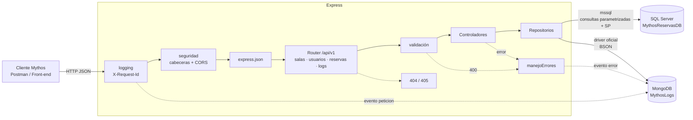
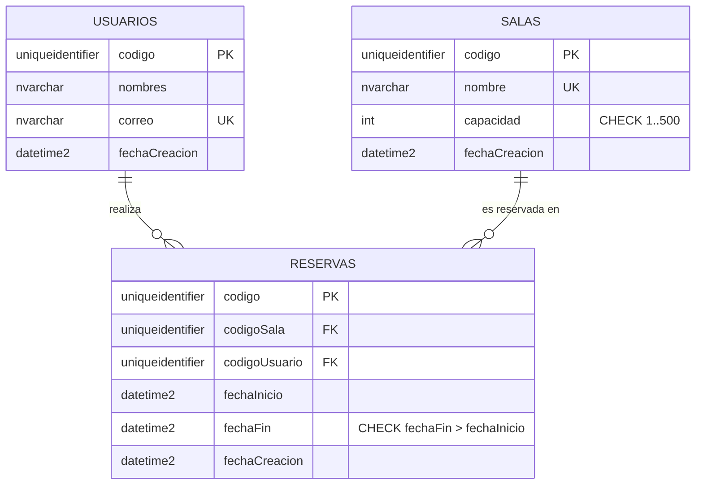

# Mythos Coworking · Sistema de Gestión de Reservas

**Mythos** es una empresa de coworking que necesita gestionar sus salas de reuniones, sus usuarios y
las reservas en tiempo real. Este repositorio contiene su backend: una API REST construida con **Node.js + Express 5** que gestiona salas de reuniones, usuarios y reservas.
Usa **SQL Server** para los datos transaccionales (esquema normalizado en 3FN con procedimientos
almacenados) y **MongoDB** para el histórico de actividad (logs) y los comentarios de las salas.

> Evaluación Parcial · Desarrollo Web Full Stack Backend · Universidad Autónoma del Perú

---

## Caso de negocio

| | |
| --- | --- |
| **Empresa** | Mythos (coworking) |
| **Necesidad** | Gestionar salas de reuniones, usuarios y reservas en tiempo real, sin reservas superpuestas |
| **Solución** | Express.js para la lógica, SQL Server para la gestión transaccional de usuarios/salas/reservas y MongoDB para el histórico de logs y los comentarios de los clientes |

## Contenido

1. [Tecnologías](#tecnologías)
2. [Arquitectura](#arquitectura)
3. [Estructura del proyecto](#estructura-del-proyecto)
4. [Instalación y ejecución](#instalación-y-ejecución)
5. [Variables de entorno](#variables-de-entorno)
6. [Documentación de la API](#documentación-de-la-api)
7. [Persistencia SQL Server](#persistencia-sql-server)
8. [Persistencia NoSQL MongoDB](#persistencia-nosql-mongodb)
9. [Middlewares](#middlewares)
10. [Pruebas](#pruebas)
11. [Cumplimiento de la rúbrica](#cumplimiento-de-la-rúbrica)

---

## Tecnologías

| Capa | Tecnología | Uso |
| --- | --- | --- |
| Runtime | Node.js ≥ 20.6 (probado con 22) | `--env-file` y `--watch` nativos, `node:test` |
| Framework | Express 5 | Routers por recurso, middlewares, manejo de errores asíncronos |
| SQL | SQL Server 2019/2022 + `mssql` | Usuarios, salas y reservas (transaccional) |
| NoSQL | MongoDB 6/7 + driver oficial `mongodb` | Logs del sistema y comentarios (documentos BSON) |
| Documentación | OpenAPI 3 + Swagger UI, `README.md`, `request.http`, colección Postman | Contrato de la API, pruebas manuales y automatizadas |

## Arquitectura

Arquitectura en capas: cada petición atraviesa los middlewares globales, llega al router del recurso,
se valida, el controlador aplica la lógica y los **repositorios** (patrón Repository) acceden a la base
correspondiente.



**¿Por qué dos bases de datos?**

- **SQL Server** garantiza integridad y consistencia (ACID) donde el negocio lo exige: no puede existir una
  reserva para una sala o un usuario inexistente, ni dos reservas superpuestas en la misma sala.
- **MongoDB** almacena información de alto volumen y forma variable (logs, comentarios) sin bloquear las
  tablas transaccionales ni obligar a migraciones de esquema cuando aparece un nuevo tipo de evento.

## Estructura del proyecto

```text
EP-Backend/  (Mythos Coworking API)
├── database/
│   ├── sqlserver.sql            # Tablas 3FN, restricciones, índices, vista, SP y datos de ejemplo
│   └── mongodb.js               # Script mongosh: colecciones, validadores e índices (opcional)
├── docs/
│   ├── openapi.yaml             # Especificación OpenAPI 3.0 (servida en /api/v1/docs)
│   └── SUSTENTACION.md          # Guion de demostración y respuestas de metacognición
├── postman/
│   └── EP-Backend.postman_collection.json
├── src/
│   ├── config/env.js            # Lectura y validación centralizada de variables de entorno
│   ├── db/
│   │   ├── sqlserver.js         # Pool de conexiones a SQL Server
│   │   └── mongodb.js           # Cliente MongoDB, validadores $jsonSchema e índices
│   ├── repositories/            # Acceso a datos (patrón Repository)
│   │   ├── salasRepository.js
│   │   ├── usuariosRepository.js
│   │   ├── reservasRepository.js
│   │   ├── logsRepository.js
│   │   └── comentariosRepository.js
│   ├── controllers/             # Lógica de cada endpoint
│   ├── routes/                  # Un Router por recurso + router principal /api/v1
│   ├── middlewares/
│   │   ├── logging.js           # Logging de peticiones (consola + MongoDB)
│   │   ├── validacion.js        # Validación declarativa de params, query y body
│   │   ├── seguridad.js         # Cabeceras de seguridad y CORS
│   │   └── manejoErrores.js     # 404, 405 y manejador global de errores
│   ├── utils/                   # ErrorHttp, traducción de errores SQL, auditoría
│   ├── app.js                   # Configuración de Express
│   └── index.js                 # Arranque, conexión a bases y cierre ordenado
├── test/                        # Pruebas con node:test (sin dependencias extra)
├── request.http                 # Peticiones listas para REST Client (VS Code)
├── docker-compose.yml           # SQL Server + MongoDB para desarrollo (opcional)
├── .env.example
└── package.json
```

## Instalación y ejecución

### Requisitos

- Node.js 20.6 o superior.
- SQL Server con **autenticación SQL (modo mixto)** y **TCP/IP habilitado** en el puerto 1433.
- MongoDB local (Compass / `mongod`) o una URI de MongoDB Atlas.
- Opcional: Docker Desktop para levantar ambas bases con `docker compose up -d`.

### Pasos

```bash
# 1. Clonar e instalar dependencias
git clone https://github.com/TheDanielrity/EP-Backend.git
cd EP-Backend
npm install

# 2. Configurar variables de entorno
cp .env.example .env              # PowerShell: Copy-Item .env.example .env
#    editar .env con el usuario y la contraseña reales de SQL Server

# 3. Crear la base de datos SQL (desde SSMS / Azure Data Studio, o con sqlcmd)
sqlcmd -S localhost -U sa -P "<clave>" -C -i database/sqlserver.sql

# 4. (Opcional) Inicializar MongoDB manualmente; la API también lo hace al arrancar
mongosh "mongodb://127.0.0.1:27017" database/mongodb.js

# 5. Iniciar la API
npm run dev        # desarrollo, se reinicia al guardar cambios
npm start          # producción
```

La API queda disponible en `http://localhost:3000/api/v1` y su documentación interactiva en
**`http://localhost:3000/api/v1/docs`** (Swagger UI). Al iniciar, el servidor:

1. Valida las variables de entorno obligatorias.
2. Se conecta a SQL Server y a MongoDB (si alguna falla, no arranca y muestra el motivo).
3. Crea/actualiza en MongoDB las colecciones con su validador y sus índices.
4. Registra un evento `sistema` y, con `Ctrl+C`, cierra las conexiones de forma ordenada.

### Scripts npm

| Script | Descripción |
| --- | --- |
| `npm run dev` | Inicia con `--watch` y carga `.env` |
| `npm start` | Inicia el servidor cargando `.env` |
| `npm test` | Ejecuta las pruebas automatizadas con `node:test` |

## Variables de entorno

| Variable | Ejemplo | Descripción |
| --- | --- | --- |
| `PORT` | `3000` | Puerto HTTP |
| `NODE_ENV` | `development` | Entorno de ejecución |
| `CORS_ORIGIN` | `*` | Origen permitido por CORS |
| `SQL_SERVER` / `SQL_PORT` | `localhost` / `1433` | Servidor SQL Server |
| `SQL_DATABASE` | `MythosReservasDB` | Base creada por `database/sqlserver.sql` |
| `SQL_USER` / `SQL_PASSWORD` | `sa` / `***` | **Obligatorias**. Login SQL |
| `SQL_ENCRYPT` / `SQL_TRUST_CERTIFICATE` | `false` / `true` | Opciones TLS (en Azure: `true` / `false`) |
| `MONGO_URI` | `mongodb://127.0.0.1:27017` | Conexión a MongoDB |
| `MONGO_DATABASE` | `MythosLogs` | Base de logs y comentarios |
| `MONGO_LOGS_TTL_DIAS` | `90` | Días de retención de logs (índice TTL) |

## Documentación de la API

**URL base:** `http://localhost:3000/api/v1` · **Formato:** JSON (`Content-Type: application/json`)

### Documentación OpenAPI / Swagger

El contrato completo de la API está en [`docs/openapi.yaml`](docs/openapi.yaml) (**OpenAPI 3.0.3**):
24 operaciones con sus parámetros, cuerpos, esquemas de respuesta, ejemplos y códigos de error.

| Recurso | URL |
| --- | --- |
| Swagger UI interactivo (*Try it out*) | `http://localhost:3000/api/v1/docs` |
| Especificación en YAML | `http://localhost:3000/api/v1/openapi.yaml` |

También se puede abrir en <https://editor.swagger.io> (*File → Import file*) o importar en Postman
(*Import → docs/openapi.yaml*) para generar la colección automáticamente. Swagger UI se carga desde CDN
con versión fija, por lo que no agrega dependencias al proyecto.

Además, la documentación ejecutable está en [`request.http`](request.http) (REST Client) y en
[`postman/EP-Backend.postman_collection.json`](postman/EP-Backend.postman_collection.json)
(importar en Postman y ejecutar con *Run collection*: incluye pruebas de código de estado).

### Modelo de Madurez de Richardson — Nivel 2

| Nivel | Requisito | Cómo se cumple |
| --- | --- | --- |
| 0 | HTTP como transporte | JSON sobre HTTP |
| 1 | Recursos | URIs por sustantivo: `/salas`, `/usuarios`, `/reservas`, sub-recursos `/salas/{codigo}/reservas` |
| 2 | Verbos y códigos HTTP | `GET` lee (seguro e idempotente), `POST` crea, `PUT` reemplaza (idempotente), `DELETE` elimina; respuestas `200/201/204/400/404/405/409/413/500/503`; `201` incluye cabecera `Location`; `405` incluye cabecera `Allow` |

### Endpoints

#### Sistema

| Método | Ruta | Descripción | Éxito |
| --- | --- | --- | --- |
| GET | `/` | Índice con los recursos disponibles | 200 |
| GET | `/salud` | Estado de SQL Server y MongoDB | 200 / 503 |
| GET | `/docs` | Documentación interactiva Swagger UI | 200 |
| GET | `/openapi.yaml` | Especificación OpenAPI 3.0 | 200 |

#### Salas

| Método | Ruta | Descripción | Éxito | Errores |
| --- | --- | --- | --- | --- |
| GET | `/salas?capacidadMinima=8` | Listar salas (filtro opcional) | 200 | 400 |
| POST | `/salas` | Crear sala | 201 + `Location` | 400, 409 nombre duplicado |
| GET | `/salas/{codigo}` | Obtener sala + valoración promedio (MongoDB) | 200 | 400, 404 |
| PUT | `/salas/{codigo}` | Reemplazar datos de la sala | 200 | 400, 404, 409 |
| DELETE | `/salas/{codigo}` | Eliminar sala | 204 | 404, 409 tiene reservas |
| GET | `/salas/{codigo}/reservas` | Reservas de la sala | 200 | 404 |
| GET | `/salas/{codigo}/comentarios` | Comentarios de la sala (MongoDB) | 200 | 404, 503 |
| POST | `/salas/{codigo}/comentarios` | Comentar y calificar la sala | 201 + `Location` | 400, 404, 503 |
| DELETE | `/salas/{codigo}/comentarios/{id}` | Eliminar comentario | 204 | 400, 404 |

#### Usuarios

| Método | Ruta | Descripción | Éxito | Errores |
| --- | --- | --- | --- | --- |
| GET | `/usuarios` | Listar usuarios | 200 | — |
| POST | `/usuarios` | Crear usuario | 201 + `Location` | 400, 409 correo duplicado |
| GET | `/usuarios/{codigo}` | Obtener usuario | 200 | 400, 404 |
| PUT | `/usuarios/{codigo}` | Reemplazar datos del usuario | 200 | 400, 404, 409 |
| DELETE | `/usuarios/{codigo}` | Eliminar usuario | 204 | 404, 409 tiene reservas |
| GET | `/usuarios/{codigo}/reservas` | Reservas del usuario | 200 | 404 |

#### Reservas

| Método | Ruta | Descripción | Éxito | Errores |
| --- | --- | --- | --- | --- |
| GET | `/reservas?codigoSala=&codigoUsuario=&desde=&hasta=` | Listar con filtros opcionales | 200 | 400 |
| POST | `/reservas` | Registrar (SP `dbo.RegistrarReserva`) | 201 + `Location` | 400, 404, 409 horario ocupado |
| GET | `/reservas/{codigo}` | Obtener reserva con nombres de sala y usuario | 200 | 400, 404 |
| PUT | `/reservas/{codigo}` | Reprogramar (SP `dbo.ActualizarReserva`) | 200 | 400, 404, 409 |
| DELETE | `/reservas/{codigo}` | Cancelar reserva | 204 | 404 |

#### Logs (MongoDB)

| Método | Ruta | Descripción | Éxito |
| --- | --- | --- | --- |
| GET | `/logs?tipo=&nivel=&desde=&hasta=&pagina=1&limite=20` | Logs paginados (máx. 100 por página) | 200 |
| GET | `/logs/resumen` | Conteo por tipo y nivel (pipeline de agregación) | 200 |

### Cuerpos de entrada

```jsonc
// POST/PUT /salas
{ "nombre": "Sala Olimpo", "capacidad": 8 }               // nombre ≤ 100, capacidad 1..500

// POST/PUT /usuarios
{ "nombres": "Ana Torres", "correo": "ana@mythos.pe" } // correo único, se guarda en minúsculas

// POST/PUT /reservas  (fechas ISO 8601 con zona horaria; se almacenan en UTC)
{
  "codigoSala": "8f1c...-uuid",
  "codigoUsuario": "2b7a...-uuid",
  "fechaInicio": "2026-12-10T09:00:00-05:00",
  "fechaFin": "2026-12-10T10:00:00-05:00"
}

// POST /salas/{codigo}/comentarios
{ "codigoUsuario": "2b7a...-uuid", "texto": "Muy buena sala", "calificacion": 5, "etiquetas": ["wifi"] }
```

Los campos no declarados se rechazan con 400 para evitar datos inesperados.

### Respuestas

Creación exitosa (`201 Created`, cabecera `Location: /api/v1/reservas/{codigo}`):

```json
{
  "codigo": "6E0B8F2C-1D2A-4F57-9E1A-0B3C4D5E6F70",
  "codigoSala": "8F1C0A6B-…",
  "nombreSala": "Sala Olimpo",
  "codigoUsuario": "2B7A9C1D-…",
  "nombresUsuario": "Ana Torres",
  "fechaInicio": "2026-12-10T14:00:00.000Z",
  "fechaFin": "2026-12-10T15:00:00.000Z",
  "fechaCreacion": "2026-10-17T20:15:00.000Z"
}
```

Todos los errores tienen la **misma forma**, lo que facilita su consumo desde el front-end:

```json
{
  "estado": 400,
  "error": "Bad Request",
  "mensaje": "Los datos enviados no son válidos",
  "detalles": [
    { "campo": "nombre", "origen": "body", "mensaje": "debe ser un texto no vacío de máximo 100 caracteres" },
    { "campo": "capacidad", "origen": "body", "mensaje": "debe ser un número entero entre 1 y 500" }
  ],
  "idPeticion": "3f9d6c1e-2b8a-4c55-9f0e-7a1b2c3d4e5f"
}
```

### Códigos de estado

| Código | Cuándo se usa |
| --- | --- |
| 200 OK | Lectura o actualización exitosa |
| 201 Created | Recurso creado (incluye cabecera `Location`) |
| 204 No Content | Eliminación exitosa / preflight CORS |
| 400 Bad Request | Validación fallida, JSON mal formado, UUID inválido, fechas invertidas |
| 404 Not Found | Ruta inexistente o recurso (sala, usuario, reserva, comentario) no encontrado |
| 405 Method Not Allowed | Verbo no soportado en la ruta (incluye cabecera `Allow`) |
| 409 Conflict | Correo o nombre de sala duplicado, horario ocupado, borrar con reservas asociadas |
| 413 Payload Too Large | Cuerpo mayor a 100 KB |
| 500 Internal Server Error | Error inesperado (el detalle solo se registra en el log, no se expone) |
| 503 Service Unavailable | MongoDB o SQL Server no disponibles (health check, logs, comentarios) |

## Persistencia SQL Server

Script: [`database/sqlserver.sql`](database/sqlserver.sql) (re-ejecutable, crea `MythosReservasDB`).



### Normalización (3FN)

| Forma normal | Justificación |
| --- | --- |
| **1FN** | Todos los atributos son atómicos; no hay listas ni grupos repetidos (p. ej. una reserva = una sala + un intervalo). |
| **2FN** | Cada tabla tiene una clave primaria simple (`codigo`), por lo que no existen dependencias parciales. |
| **3FN** | Ningún atributo no clave depende de otro atributo no clave. `Reservas` solo guarda las claves foráneas: el nombre de la sala o el correo del usuario se obtienen por JOIN (vista `vw_ReservasDetalle`), evitando redundancia y anomalías de actualización. |

### Integridad

- **PK** `UNIQUEIDENTIFIER` con `NEWSEQUENTIALID()` (evita fragmentación del índice clúster).
- **FK** `FK_Reservas_Salas` y `FK_Reservas_Usuarios` con `ON DELETE NO ACTION`: no se puede borrar una sala
  o un usuario que tenga reservas (la API responde **409**).
- **UNIQUE** `UQ_Usuarios_correo`, `UQ_Salas_nombre` → **409** con mensaje específico.
- **CHECK** de capacidad, fechas, correo y textos no vacíos (la base se protege aunque se use sin la API).
- **Índices** `IX_Reservas_Sala_Fechas` (búsqueda de solapamientos) e `IX_Reservas_Usuario`.
- Todas las consultas de la API son **parametrizadas** (`request.input(...)`): sin inyección SQL.

### Procedimientos almacenados

`dbo.RegistrarReserva` y `dbo.ActualizarReserva` se ejecutan dentro de una **transacción** con
`SET XACT_ABORT ON` y `TRY/CATCH` (ROLLBACK ante cualquier error):

1. Valida las fechas → `THROW 50001` (400).
2. Bloquea la sala con `UPDLOCK, HOLDLOCK` → `THROW 50002` si no existe (404). El bloqueo evita que dos
   peticiones simultáneas reserven el mismo horario (condición de carrera).
3. Verifica el usuario → `THROW 50003` (404).
4. Detecta solapamientos (`inicioExistente < finNuevo AND finExistente > inicioNuevo`) → `THROW 50004` (409).
5. Inserta/actualiza, hace `COMMIT` y devuelve la reserva con los nombres de sala y usuario.

`ActualizarReserva` además lanza `50005` (404) si la reserva no existe y excluye la propia reserva al
comprobar solapamientos. La traducción de códigos SQL → HTTP está en
[`src/utils/erroresSql.js`](src/utils/erroresSql.js).

## Persistencia NoSQL MongoDB

Base `MythosLogs`, inicializada automáticamente al arrancar (o con [`database/mongodb.js`](database/mongodb.js)).

### Colección `logs` — esquema flexible

Todos los documentos comparten `tipo`, `nivel` y `fecha` (validados con `$jsonSchema`); el subdocumento
`datos` es libre, de modo que cada tipo de evento guarda su propia estructura en BSON:

```js
// Petición HTTP (middleware logging)
{ tipo: 'peticion', nivel: 'info', fecha: ISODate(),
  datos: { idPeticion, metodo: 'POST', ruta: '/api/v1/reservas', estado: 201, duracionMs: 18.4, ip, agente } }

// Auditoría (controladores): qué se cambió
{ tipo: 'auditoria', nivel: 'info', fecha: ISODate(),
  datos: { idPeticion, accion: 'crear', entidad: 'reserva', codigo: '6E0B…', cambios: { fechaInicio, fechaFin } } }

// Error (manejador global)
{ tipo: 'error', nivel: 'warn', fecha: ISODate(),
  datos: { idPeticion, ruta: '/api/v1/reservas', estado: 409, mensaje: 'La sala ya está reservada en ese horario' } }

// Sistema (arranque / apagado)
{ tipo: 'sistema', nivel: 'info', fecha: ISODate(), datos: { mensaje: 'Servidor iniciado', puerto: 3000 } }
```

El `idPeticion` (también enviado en la cabecera `X-Request-Id`) permite **correlacionar** la petición, su
auditoría y su error.

### Colección `comentarios`

```js
{ _id: ObjectId(), codigoSala: '8f1c…', autor: { codigoUsuario: '2b7a…', nombres: 'Ana Torres' },
  texto: 'Excelente iluminación', calificacion: 5, etiquetas: ['wifi'], fecha: ISODate() }
```

El autor se **embebe** (desnormalización intencional, propia de NoSQL) para listar comentarios sin
consultar SQL Server. Antes de insertar, la API verifica en SQL Server que la sala y el usuario existan
(integridad entre ambas bases). `GET /salas/{codigo}` combina el dato SQL con el promedio de calificación
calculado con un pipeline `$match → $group → $project`.

### Diseño óptimo: índices

| Colección | Índice | Propósito |
| --- | --- | --- |
| logs | `{ fecha: 1 }` TTL | Borra automáticamente logs con más de `MONGO_LOGS_TTL_DIAS` días |
| logs | `{ tipo: 1, fecha: -1 }` | Filtrar por tipo ordenado por fecha (`/logs?tipo=`) |
| logs | `{ nivel: 1, fecha: -1 }` | Filtrar errores/advertencias recientes |
| comentarios | `{ codigoSala: 1, fecha: -1 }` | Comentarios de una sala, más recientes primero |
| comentarios | `{ 'autor.codigoUsuario': 1 }` | Comentarios por autor |

Los logs se escriben **después de responder** y un fallo de MongoDB nunca revierte una operación SQL ya
confirmada (se informa en consola).

Consultas útiles en `mongosh` / Compass:

```js
use MythosLogs
db.logs.find({ tipo: 'auditoria' }).sort({ fecha: -1 }).limit(10)
db.logs.find({ 'datos.idPeticion': '<X-Request-Id>' })
db.logs.aggregate([{ $group: { _id: '$tipo', total: { $sum: 1 } } }])
db.comentarios.find({ codigoSala: '<codigo>' }).sort({ fecha: -1 })
```

## Middlewares

| Middleware | Archivo | Responsabilidad |
| --- | --- | --- |
| Logging | `src/middlewares/logging.js` | Genera `X-Request-Id`, mide la duración y registra cada petición en consola y en MongoDB |
| Seguridad | `src/middlewares/seguridad.js` | `X-Content-Type-Options`, `X-Frame-Options`, `Referrer-Policy`, CORS y preflight |
| Body parser | `express.json({ limit: '100kb' })` | Convierte el JSON y limita el tamaño del cuerpo |
| Validación | `src/middlewares/validacion.js` | Valida `params`, `query` y `body` con reglas declarativas; acumula todos los errores |
| 404 / 405 | `src/middlewares/manejoErrores.js` | Ruta inexistente y método no permitido (cabecera `Allow`) |
| Errores | `src/middlewares/manejoErrores.js` | Manejador global: traduce errores SQL, JSON inválido y errores de dominio a una respuesta uniforme |

Express 5 propaga automáticamente al manejador global los errores de los controladores `async`, por lo
que no se necesitan bloques `try/catch` repetidos en cada ruta.

## Pruebas

```bash
npm test
```

Las pruebas (`test/`) usan el runner nativo `node:test` y no requieren bases de datos:

- **`api.test.js`**: levanta Express en un puerto aleatorio y verifica 400 (validación con detalle por campo,
  JSON mal formado, UUID inválido, fechas invertidas), 404, 405 con `Allow`, 503 sin bases, cabeceras de
  seguridad, `X-Request-Id` y la publicación de la documentación OpenAPI/Swagger.
- **`unidad.test.js`**: traducción de errores SQL → HTTP y reglas de validación.

Para la integración con bases reales: ejecutar `request.http` de arriba hacia abajo o la colección de
Postman con *Run collection* (cada petición valida su código de estado esperado).

## Cumplimiento de la rúbrica

| Criterio | Nivel "Logrado" | Evidencia en el proyecto |
| --- | --- | --- |
| Arquitectura de Servidor | Express configurado con Router y Middlewares funcionales | `src/app.js`, un `Router` por recurso en `src/routes/`, middlewares de logging, validación, seguridad y errores; variables de entorno y scripts npm |
| Persistencia SQL | DB normalizada con relaciones e integridad referencial | 3FN, PK/FK/UNIQUE/CHECK con nombre, índices, vista, SP transaccionales con bloqueo y ROLLBACK |
| Diseño API REST | Uso correcto de verbos, rutas y códigos de estado | Nivel 2 de Richardson, CRUD completo, sub-recursos, `Location`, `Allow`, 200/201/204/400/404/405/409/503; contrato OpenAPI 3 con Swagger UI |
| Persistencia NoSQL | MongoDB para logs con diseño óptimo | Esquema flexible validado con `$jsonSchema`, índices compuestos y TTL, auditoría correlacionada, agregaciones, comentarios |
| Entrega | GitHub sin `node_modules`, script `.sql` y `.env.example` | `.gitignore`, `database/sqlserver.sql`, `.env.example`, colección Postman, `docs/openapi.yaml` |

Guion de demostración y preguntas de reflexión: [`docs/SUSTENTACION.md`](docs/SUSTENTACION.md).

## Referencias

- OpenAPI Specification 3.0.3: <https://spec.openapis.org/oas/v3.0.3>
- Richardson Maturity Model — Martin Fowler: <https://martinfowler.com/articles/richardsonMaturityModel.html>
- Express 5: <https://expressjs.com/en/guide/routing.html>
- Driver `mssql`: <https://www.npmjs.com/package/mssql>
- Driver de MongoDB para Node.js: <https://www.mongodb.com/docs/drivers/node/current/>
- Validación de esquemas en MongoDB: <https://www.mongodb.com/docs/manual/core/schema-validation/>
- Índices TTL: <https://www.mongodb.com/docs/manual/core/index-ttl/>
